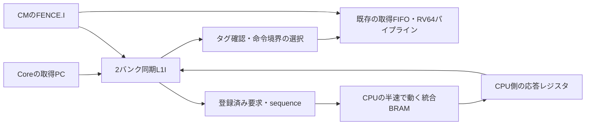

# RV64 L1命令キャッシュの実装・比較結果

更新日: 2026-09-05。対象: **LFE5UM5G-85F / CABGA381 / speed 8**。
[アーキテクチャ計画](RV64_ARCHITECTURE_PLAN.md)の命令供給改善を実装した。

**この文書は124.8 MHzタイミング改修前の比較記録。** 現在の4 KiB版は
Texoでsetup +0.064 ns / hold +0.290 nsを満たした。
現在の性能値・bitstream・残作業は[124.8 MHz改修結果](RV64_124P8_TIMING.md)を参照。

## 改修前の判断と採用条件

**単発行インオーダーRV64＋静的順次予測＋4 KiB L1命令キャッシュ**を、
124.8 MHzを満たすための改修候補とする。合成対象は `HardwareCached4KTestTop`、
ボード相当シミュレーションは `--static-predictor --icache-kib 4` で選ぶ。

**CPU 124.8 MHz／メモリ62.4 MHzのタイミング成立が採用の必須条件。**
前版の採用判断は撤回する。以下の数値はタイミング改修前の比較記録であり、
現在の改修中RTLの性能値ではない。

同じ改修前RTL・メモリ・PLL・配置条件でキャッシュなしの軽量構成と比較すると、
4本の診断ループの推定処理速度は幾何平均 **1.575倍**。
起動初期化を含めた場合は **1.514倍**。LUT4は11,190 → **11,047**、
FFは4,625 → **4,323**、EBRは136 → **146 / 208個**になった。

これはRTLの実行サイクルと配線後STAを組み合わせた比較値である。
**124.8 MHzの目標は全12回の配置配線で未達。bitstream生成・実機検証は未実施。**
1.575倍は実機測定値でも124.8 MHzでの速度比でもない。固定PLL条件でのsetup/holdを
満たしたうえで同じ124.8 MHzの実行時間を比べ、実機確認を行う必要がある。

4 KiB版を選ぶ理由は、今回の3 seedsの中央値で4本の診断ループが最も速く、
容量検査2本も含めた6本の集計でも最も速かったため。ただし、3 seedsでは
配置のばらつきを十分に見切れない。4 KiB版と8 KiB版の順位はプログラムと配置に依存する。
既存の引数省略時のTAGE構成は比較用に残り、採用構成は上記のtop/引数で明示する。

## 実装内容

| 項目 | 実装 |
| --- | --- |
| 容量 | 2 / 4 / 8 KiBをパラメータで選択。4 KiBは `INDEX_BITS=8` |
| 構成 | direct mapped、64-bit line、偶数・奇数行の2バンク |
| RAM | タグ、valid、データ、4個の圧縮命令判定ビットを同じ同期EBRに格納 |
| 命令供給 | 現在行と次行を並行して読む。温まった逐次実行では1命令/clock |
| 命令境界 | PC+2/PC+4、64-bit行を跨ぐ32-bit命令、32-bit物理アドレスの折返し |
| ミス処理 | 1件の要求を保持し、返却アドレスとsequenceが一致した応答だけ補充 |
| 先読み | 次行を先読み。現在行の補充完了と同時に次の不足行を要求 |
| 競合 | 同じバンク・行への同時read/writeはvalidを抑止し、EBRの衝突時データに依存しない |
| リセット・再ロード | CPU再開時に全行のvalidをscrub。デバッグ書換え前の命令を再利用しない |
| `FENCE.I` | 先行LSUの完了後にCMで一度だけ発行。キャッシュ無効化と若い命令の破棄を行い、直後のPCから再開 |

`InstructionCache.veryl` を追加し、HardwareTestTop / HardwareCoreTestTopへ接続した。
従来のInstructionBufferも `FENCE.I` 後に応答パイプラインを排出してから再取得する。
HardwareMemoryは命令要求のsequenceをアドレス・データと揃えて返す。
接続は既存のCPU:メモリ=2:1、位相の揃った関連クロックを前提とする。

キャッシュのタグ照合が次PC更新を遅くするため、圧縮命令の判定を補充時に計算して
EBRの空き幅へ格納した。Coreでは、要求受理条件が既に除外している待ち・flush条件を
PC更新の優先選択で重複させないよう整理した。発行幅や分岐回復の段数は同じである。

`FENCE.I` のfunct12・rs1・rd予約フィールドは命令の合法性判定でも無視する。
自己書換えコード、直後の命令、行を跨ぐ命令、圧縮命令で確認した。
これは単一hartの命令取得との整合性を扱う実装である。
[RISC-V公式 Zifencei仕様](https://docs.riscv.org/reference/isa/v20260120/unpriv/zifencei.html)



## 面積と配線後タイミング

同一のnextpnr 0.6-3build5、heap placer、router1、seeds **1 / 2 / 5**。
PLLはCPU124.8 / メモリ62.4 MHz、LPF、speed grade、CSR CE制約も共通。
比較用のキャッシュなし構成も、今回の最終Coreから合成し直した。
前回の予測器比較の周波数を今回の基準値へ流用していない。

| 構成 | LUT4 | FF | EBR | CPU Fmax中央値 MHz | seed最小〜最大 MHz |
| --- | ---: | ---: | ---: | ---: | ---: |
| 静的・従来16 Bバッファ | 11,190 | 4,625 | 136 | 100.291 | 99.960〜103.199 |
| 静的＋2 KiB L1I | 11,042 | 4,320 | 146 | 88.952 | 82.021〜100.341 |
| **静的＋4 KiB L1I** | **11,047** | **4,323** | **146** | **98.814** | **83.479〜107.759** |
| 静的＋8 KiB L1I | 11,054 | 4,326 | 146 | 90.293 | 87.017〜91.241 |

2/4/8 KiBはいずれも2論理RAM → 10個の追加EBRとなった。
容量を減らしてもEBR数は減らず、8 KiBへの拡張も同じEBR数で可能。
4 KiB版はEBRが62個残るため、今後のデータ供給改善や小型予測器の余地を残している。
残数をそのまま追加キャッシュの有効容量に換算することはできない。

採用4 KiB版の3 seedsの最大境界遅延は、CPU→メモリ2.579 ns、
メモリ→CPU7.795 nsで、現在の約8.013 nsの境界条件内。
全体の未達要因はCPU内部である。2 KiB/8 KiB版にはメモリ→CPU境界も未達のseedがある。
各結果はタイミング検査の失敗を記録しており、`--timing-allow-fail` による
配置配線コマンドの完了をタイミング合格には数えていない。

## 実行サイクルと速度

最初のcommitから終端commitまでを両端含みで数える。リセット時のscrubを除き、
その後のcold miss、分岐回復、LSU待ちは含む。表の実行区間は両クロックエッジ順で一致した。

| ワークロード | 従来16 B | 2 KiB | 4 KiB | 8 KiB |
| --- | ---: | ---: | ---: | ---: |
| alu_chain | 11,783 | 6,430 | 6,430 | 6,430 |
| branch_pattern | 12,809 | 8,210 | 8,210 | 8,210 |
| call_return | 10,761 | 6,420 | 6,420 | 6,420 |
| load_store | 7,689 | 5,648 | 5,648 | 5,648 |
| capacity_3k | 12,431 | 12,922 | 7,402 | 7,402 |
| capacity_6k | 12,381 | 15,478 | 13,216 | 8,528 |

`推定時間[μs] = 実行サイクル / 推定周波数[MHz]`。
推定周波数は各seedの `min(CPU Fmax, 2×memory Fmax, 1000/最大境界遅延ns)` の中央値。
各ワークロードの従来構成に対する速度比を求め、その幾何平均を使う。
同じ2:1比で周波数を変更できると仮定したSTA上の比較で、実機の測定時間ではない。

| 集計（従来の静的構成=1） | 2 KiB | 4 KiB | 8 KiB |
| --- | ---: | ---: | ---: |
| 診断4本・実行区間 | 1.417倍 | **1.575倍** | 1.439倍 |
| 診断4本・起動初期化込み | 1.389倍 | **1.514倍** | 1.333倍 |
| 容量検査も含めた6本・実行区間 | 1.161倍 | **1.452倍** | 1.428倍 |

容量検査は境界を意図的に跨ぐ人工的なループであり、アプリケーションの代表値にはしない。
6 KiBループでは4 KiB版は従来構成の0.923倍、8 KiB版は1.307倍。
**実際の主力コードが4 KiBを超える場合は8 KiB版で再評価する。**
小容量で収まらないコードでは、タグ付きミス要求の待ちが従来の連続取得より長くなる。

4 KiB版のリセット/`FENCE.I` は両バンクの256行を1行/clockでscrubする。
最初のcommitは270〜271クロック目。繰返し無効化を行う `fence_i` 検査の実行区間は
従来365、4 KiB版1,362クロックだった。この検査は速度平均から除外している。
短いプログラムの頻繁な起動や自己書換えには、初期化・無効化のコストが残る。

## 検証結果

- Veryl check/fmt、Rust fmt、差分チェック: 合格。
- Rust全回帰: **139項目合格**。Core回復21項目、命令キャッシュ10項目を含む。
- キャッシュ単体: ヒット時1命令/clock、行跨ぎの両方向、アドレス折返し、タグ競合、
  ミス中redirect、古い応答の破棄、再ロード、繰返し無効化、混在16/32-bit窓を確認。
- ECP5マッピング後のキャッシュモデル（2 KiB）: 10 EBRへの変換、等価性検査、補充・競合・無効化を確認。
- 通常Coreモデル: TAGE/bimodal/静的のそれぞれ **98 ELF合格、計294実行**。
- ボード相当モデル: 従来/2/4/8 KiBのそれぞれ98 ELFを両エッジ順で実行し、**784実行合格**。
- 98 ELFの内訳: 既存8、ACT4 I 51、ACT4 Zca 32、診断4、新規キャッシュ検査3。
- 配置配線: 4構成×3 seedsを完了。124.8 MHzでのタイミング合格は **0/12**。

元report、検証ログ、実行コマンド、ソースとELFのSHA-256は
[計測記録](../toolchain/measurements/2026-09-05-rv64-l1i/README.md)に保存した。

## 次の改良と完了条件

1. **データ待ちの短縮**: 要求→BRAM→応答→依存命令の各待ちを計測する。
   ポート接続、load-use、必要なら小型L1Dを比較し、store順序とFENCE.Iを保ったうえで
   `load_store` と実アプリケーションの時間が短くなることを採用条件にする。
2. **CPU内部と境界の配線**: キャッシュのhit判定→PC、bypass→redirectを局所化する。
   段追加はCPIと周波数の積で判断し、実際に選ぶPLLでsetup/holdを閉じる。
3. **命令キャッシュの追加改良**: 大きなコードでの4/8 KiB再選定、ミス要求の重畳、
   より速い無効化を比較する。ヒット率だけでなく、起動とFENCE.Iを含めた時間も測る。
4. **小型分岐先/復帰予測**: 命令供給が改善した状態でBTB/RASの利益と配線負荷を測る。
   TAGEと比較し、追加面積に見合う実行時間の短縮が得られる構成を選ぶ。
5. **実機検証、その後に発行幅の拡張**: 確定PLL/bitstreamでELF・ACT4・counterを確認する。
   2命令発行やOoOは、供給帯域と独立命令の余地を確認してから別段階で評価する。

## 再現手順

リポジトリのルートで実行する。ACT4 ELFの準備は [README](README.md)を参照。

```sh
cargo test --locked --offline -p verify-riscv
cargo run --locked --offline -p verify-riscv --bin rv64-riscv-tests -- --static-predictor --benchmarks --max-cycles 100000
cargo run --locked --offline -p verify-riscv --bin rv64-riscv-tests -- --static-predictor --cache-tests --max-cycles 100000
cargo run --locked --offline -p verify-riscv --bin verify-riscv -- \
  --static-predictor --icache-kib 4 --hardware-memory-rtl \
  riscv/build/rv64i-subset/*.elf riscv/build/rv64-benchmarks/*.elf riscv/build/rv64-cache/*.elf \
  third_party/riscv-arch-test/work/rica-rv64i/elfs/rv64i/I/*.elf \
  third_party/riscv-arch-test/work/rica-rv64i/elfs/rv64i/Zca/*.elf
cargo build --release --locked --offline -p verify-riscv --bin nextpnr-riscv
target/release/nextpnr-riscv HardwareStaticTestTop
target/release/nextpnr-riscv HardwareCached2KTestTop
target/release/nextpnr-riscv HardwareCached4KTestTop
target/release/nextpnr-riscv HardwareCached8KTestTop
python3 toolchain/measurements/run_rv64_architecture_ab.py \
  --static riscv/build/riscv-hardware-static-test-125.nextpnr.json \
  --cache2k riscv/build/riscv-hardware-cached-2k-test-125.nextpnr.json \
  --cache4k riscv/build/riscv-hardware-cached-4k-test-125.nextpnr.json \
  --cache8k riscv/build/riscv-hardware-cached-8k-test-125.nextpnr.json \
  --output /tmp/rica-rv64-l1i-reproduction
```

出力先には未使用のディレクトリを指定する。P&R比較スクリプトはbitstreamを生成・書き込みしない。
